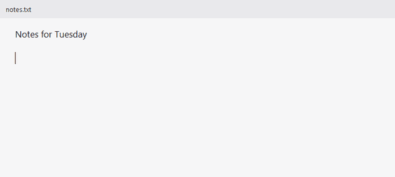

# hotmic

**Press a hotkey, speak, press it again: the text is typed into whatever app you're using.**
Speech recognition runs on your own computer. No cloud, no account, no subscription.



- Works in any app: editors, browsers, chat, terminals, office apps.
- Fast and accurate: NVIDIA's [Parakeet TDT 0.6B v2](https://huggingface.co/nvidia/parakeet-tdt-0.6b-v2) English model, about 0.2–0.5 s to transcribe a sentence on an ordinary CPU.
- Private: audio never leaves your computer. The only network access is the one-time model download.
- Small and quiet: a pill appears at the bottom of the screen while you talk, and nothing else. It never takes the keyboard focus away from your app.
- Pick the microphone from the pill while you talk.
- Removes filler words ("um", "uh").
- **Windows 10/11** and **Linux** (developed on KDE Plasma 6 on Wayland; GNOME and X11 also work). macOS is planned.

## Install

### Windows

1. Download `hotmic-…-windows-x64-setup.exe` from the [latest release](https://github.com/SamuelCGilbert/hotmic/releases/latest) and run it. It installs for your user only and doesn't need admin rights.
   Windows SmartScreen may warn that the app is unrecognized, because it isn't code-signed. Click **More info → Run anyway**.
2. On first start, hotmic downloads the speech model (about 650 MB). A pill shows the progress.
3. Press **Ctrl+Shift+D** in any app, speak, then press **Ctrl+Shift+D** again. Press **Esc** to cancel.

hotmic sits in the notification area (system tray). Its menu shows the status and has the settings file, the log folder, a GPU switch and **Quit**. The installer can also start hotmic when you sign in.

No installer wanted? Use the `-portable.zip`: unzip it anywhere and run `hotmic.exe`.

### Linux

You need an x86_64 system with glibc 2.35 or newer (Ubuntu 22.04+, Debian 12+, Fedora 36+, and similar) and systemd.

```sh
tar -xzf hotmic-*-linux-x86_64.tar.gz
cd hotmic-*-linux-x86_64
./install.sh
```

`install.sh` installs for your user only (into `~/.local/share/hotmic`, with the `hotmic` command in `~/.local/bin`) and:

- starts hotmic as a systemd user service that runs whenever you're logged in,
- sets up the **Ctrl+Shift+D** shortcut on **KDE Plasma** and **GNOME** (`--shortcut Meta+H` for another one). On other desktops, bind a shortcut to `hotmic toggle` yourself,
- checks that hotmic may use `/dev/uinput` to press the paste keys, and offers to fix it.

On Linux, Wayland doesn't let apps type into other apps directly, so hotmic puts the text on the clipboard, presses the paste keys through a virtual keyboard (`/dev/uinput`), and then restores what was on your clipboard before. It uses [CopyQ](https://hluk.github.io/CopyQ/) or KDE's Klipper when they're running (they keep images on the clipboard intact), or `wl-clipboard` otherwise. In terminals it presses Shift+Insert instead of Ctrl+V (KDE detects the terminal automatically).

To uninstall: `~/.local/share/hotmic/install.sh --uninstall` (add `--purge` to delete your settings and the model as well).

### From source (any platform, for developers)

```sh
pipx install git+https://github.com/SamuelCGilbert/hotmic
hotmic
```

On Linux you also need PortAudio (`libportaudio2`) and Tk (`python3-tk`), and you bind `hotmic toggle` to a shortcut yourself.

## Settings

Settings are in `config.json`. On Windows, open it from the tray menu (**Settings file**). On Linux it's `~/.config/hotmic/config.json`. Run `hotmic paths` to see where everything is. Restart hotmic after you change a setting (Windows: **Quit** in the tray menu, then start it from the Start menu; Linux: `systemctl --user restart hotmic`).

Only put the settings you want to change in the file, for example:

```json
{
  "hotkey": "ctrl+alt+space",
  "remove_fillers": false
}
```

| Setting | Default | What it does |
|---|---|---|
| `hotkey` | `"ctrl+shift+d"` | Windows only. Modifiers `ctrl`, `shift`, `alt`, `win` plus a letter, digit, `f1`–`f24` or `space`. On Linux, change the shortcut in your desktop's settings. |
| `model` | `"nemo-parakeet-tdt-0.6b-v2"` | Any [onnx-asr](https://github.com/istupakov/onnx-asr) model. `"nemo-parakeet-tdt-0.6b-v3"` understands 25 European languages. |
| `quantization` | `"auto"` | `"auto"` uses the smaller `int8` model on the CPU (650 MB) and the full model on a GPU (2.5 GB). `"int8"`, or `null` for the full model. |
| `device` | `"auto"` | `"cpu"`, `"directml"` (Windows: any DirectX 12 GPU), `"cuda"` (source installs with `onnxruntime-gpu`). `"auto"` means CUDA if available, else the CPU. |
| `remove_fillers` | `true` | Remove "um", "uh" and the like. |
| `trailing_space` | `true` | Add a space after the text, so dictations in a row join up. |
| `input_device` | `null` | Microphone to use when you haven't picked one in the pill. `null` = the system default. |
| `passthrough_apps` | T3 Code | Windows: while one of these programs (exe names) has focus, the hotkey goes to that program instead. |
| `pulse_source` | `null` | Linux: preferred PulseAudio/PipeWire source name, or a list (the first one that's plugged in wins). See `pactl list short sources`. |
| `linux_paste_keys` | `"auto"` | Linux: `"ctrl+v"`, `"shift+insert"` or `"ctrl+shift+v"` to always use those keys. |
| `linux_typer` | `"auto"` | Linux: `"uinput"`, `"wtype"`, `"ydotool"`, or `"clipboard"` (only copy the text). |

### CPU or GPU?

The CPU is the default: it's fast enough, it downloads less, and it leaves your graphics card alone (for games, for example). On Windows with a discrete GPU, **Use the GPU (DirectML)** in the tray menu makes long dictations faster, but downloads the 2.5 GB full model and keeps about 2.5 GB of video memory in use while hotmic runs.

Time to transcribe, Windows desktop (Intel i5-13600KF, NVIDIA RTX 4070):

| Audio | CPU, int8 (default) | GPU (DirectML), full model |
|---|---|---|
| 3 s | 0.13–0.46 s | 0.19 s |
| 9 s | 0.22–0.44 s | 0.17 s |
| 27 s | 0.97 s | 0.24 s |

On a laptop with an AMD Ryzen 5 7640U, the CPU takes about 0.2–0.35 s for a typical sentence.

## Troubleshooting

- **Nothing happens when I press the hotkey (Windows).** Another app may own Ctrl+Shift+D; hotmic then shows an error at startup. Pick another `hotkey`. Apps running as administrator can't receive typed text from a normal app; run hotmic as administrator too if you need that.
- **Nothing happens (Linux).** Check the service: `systemctl --user status hotmic`, and run `hotmic toggle` in a terminal. If it says hotmic isn't running, see `journalctl --user -u hotmic`.
- **The text isn't typed (Linux).** See the log (`~/.local/state/hotmic/hotmic.log`). Usually `/dev/uinput` isn't writable: run `install.sh` again and accept the fix, or add the udev rule it prints. If a paste fails, hotmic shows the text in a notification so it isn't lost.
- **Ctrl+V goes into a terminal as `^V`.** hotmic detects terminals on KDE. Elsewhere, set `"linux_paste_keys": "shift+insert"`, or add your terminal's window class to `linux_terminal_apps`.
- **Wrong microphone.** Click the microphone name on the pill while it's listening and pick another one. hotmic remembers it.
- **The model download fails.** Check your internet connection and look in the log. The next time you press the hotkey, hotmic tries again. Models are kept in `%LOCALAPPDATA%\hotmic\models` (Windows) or `~/.local/share/hotmic/models` (Linux).

The log file is in `%LOCALAPPDATA%\hotmic` (Windows; tray menu → **Log folder**) or `~/.local/state/hotmic` (Linux). It contains the text you dictated, so read it before you share it.

## Feedback and contributing

- Found a bug? [Open a bug report](https://github.com/SamuelCGilbert/hotmic/issues/new?template=bug_report.yml).
- Have an idea? [Suggest a feature](https://github.com/SamuelCGilbert/hotmic/issues/new?template=feature_request.yml), or start a thread in [Discussions](https://github.com/SamuelCGilbert/hotmic/discussions).
- Want to help? See [CONTRIBUTING.md](CONTRIBUTING.md). macOS support and more Linux desktops are especially welcome.

## Credits

- Speech model: [NVIDIA Parakeet TDT 0.6B v2](https://huggingface.co/nvidia/parakeet-tdt-0.6b-v2), licensed [CC-BY-4.0](https://creativecommons.org/licenses/by/4.0/). hotmic downloads the [ONNX conversion by Ilya Stupakov](https://huggingface.co/istupakov/parakeet-tdt-0.6b-v2-onnx) at first start; the weights aren't part of this repository or the releases.
- [onnx-asr](https://github.com/istupakov/onnx-asr) (MIT) runs the model with [ONNX Runtime](https://onnxruntime.ai/) (MIT).
- Audio: [sounddevice](https://github.com/spatialaudio/python-sounddevice) (MIT) and [PortAudio](https://www.portaudio.com/) (MIT). Tray icon on Windows: [pystray](https://github.com/moses-palmer/pystray) (LGPL-3.0) and [Pillow](https://python-pillow.org/) (MIT-CMU). Also [NumPy](https://numpy.org/) (BSD) and [Hugging Face Hub](https://github.com/huggingface/huggingface_hub) (Apache-2.0).

## License

hotmic is free software, licensed under the [GNU General Public License v3.0 or later](LICENSE).
